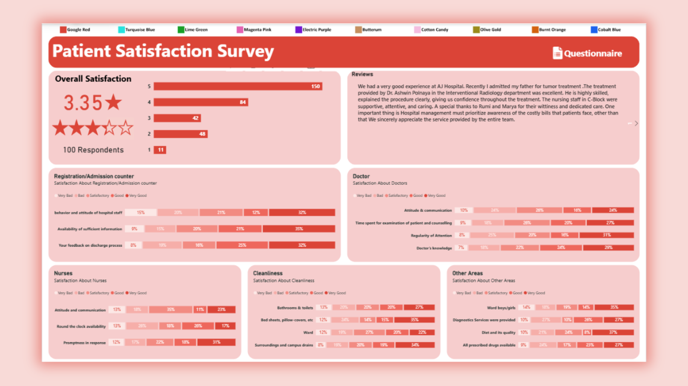
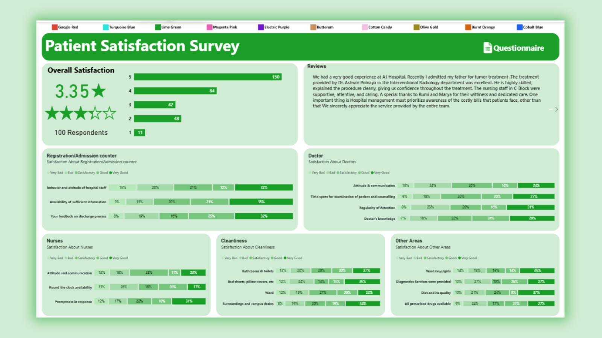
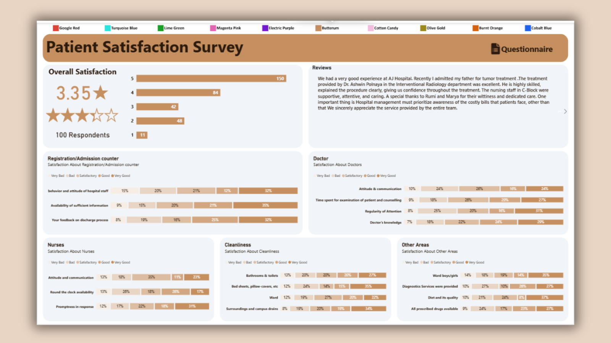
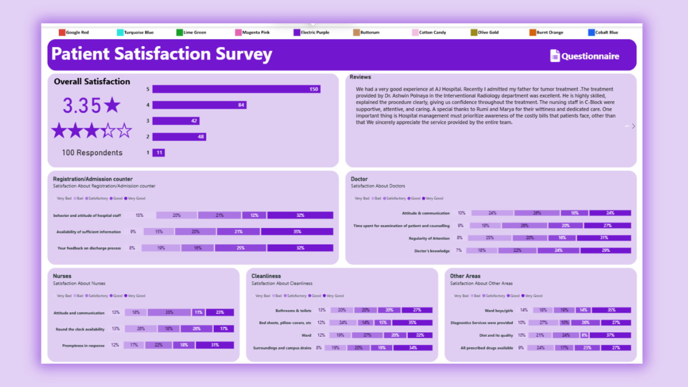
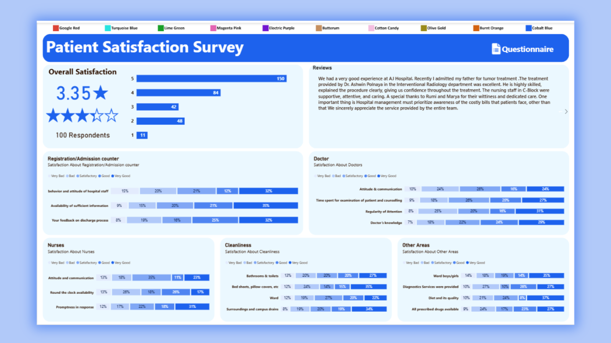
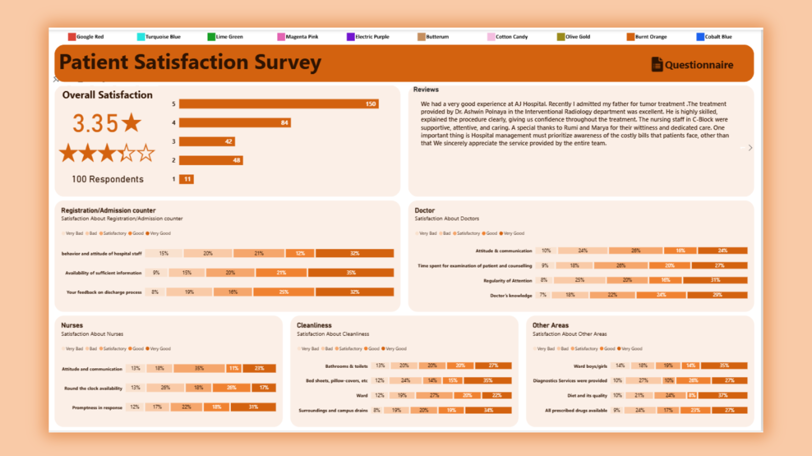

   <!---------------Start Of File-------------------->
  <!--Introduction--->
    <h1>🏥 Hospital Inpatient Satisfaction Survey Dashboard</h1>
    

       An automated, near real-time Power BI analytics solution designed to evaluate, track, and monitor inpatient satisfaction across key hospital departments and operational services, featuring <strong>10 customizable UI themes</strong>.
    

   <!---Tags to be Edited----->
   

     &nbsp;
     &nbsp;
     &nbsp;
    
    
  

  <!-----Project Overview--->
  <h2>📋 Project Overview</h2>

  This project captures, processes, and visualizes inpatient feedback to help hospital administration identify service bottlenecks, measure departmental performance, and continuously improve overall patient care. By integrating cloud-based data collection with automated business intelligence and interactive theme switching, the dashboard provides hospital leadership with up-to-date, customizable visibility into patient experiences without the need for manual data handling or static reporting.

<!----------Data Pipeline & Architecture---------------->
<h2>🔄 Data Pipeline & Architecture</h2>

  The solution follows a streamlined, zero-maintenance data pipeline:
  <ul>
    <li><strong>Data Collection (Google Forms):</strong> Inpatient feedback is gathered digitally via a structured Google Form covering 19 key performance indicators across 6 core hospital operational areas.</li>
    <li><strong>Cloud Data Storage (Google Sheets):</strong> Every survey submission is automatically logged in real time into a connected Google Sheet, acting as a centralized, lightweight cloud database.</li>
    <li><strong>Automated Ingestion & Refresh (Power BI):</strong> Power BI connects directly to the online Google Sheet via a web data connector. A scheduled refresh is configured to run <strong>every hour</strong>, ensuring stakeholders always view the latest sentiment metrics and response trends.</li>
  </ul>

<!--------UI/UX & Interactive Theme Switching------------->
<h2>🎨 UI/UX & Interactive Theme Switching</h2>

  To enhance user accessibility, presentation versatility, and visual comfort across different viewing environments, the dashboard includes <strong>10 built-in color themes</strong>:
  <ul>
    <li><strong>10 Distinct Visual Themes:</strong> Users can dynamically toggle between 10 curated color palettes (ranging from clinical light modes to high-contrast dark modes) without altering underlying data filters or visual states.</li>
    <li><strong>Bookmark Architecture:</strong> Each theme state is engineered using dedicated Power BI <strong>Bookmarks</strong> configured specifically to update display properties while preserving active slicer selections.</li>
    <li><strong>Bookmark Navigator Button:</strong> A sleek, single-click <strong>Bookmark Navigator</strong> is integrated into the dashboard header, allowing stakeholders to seamlessly switch themes on the fly during executive reviews.</li>
  </ul>

<!--------Statistical Methodology & Visualization------------->
<h2>📊 Statistical Methodology & Visualization</h2>
<ul>
  <li><strong>Likert Scale Analysis:</strong> All survey items utilize a standardized Likert scale to systematically quantify subjective patient experiences into measurable statistical metrics, enabling clear tracking of satisfaction levels over time.</li>
  <li><strong>100% Stacked Bar Charts:</strong> Each of the six hospital sections is visualized using 100% stacked bar charts. This visualization approach highlights the exact proportional distribution of patient sentiment (positive, neutral, and negative responses) within each category, allowing administrators to easily compare relative performance across different departments regardless of total response volume.</li>
</ul>

<!--------Survey Framework (6 Core Sections)------------->
<h2>🏥 Survey Framework (6 Core Sections)</h2>

  The 19-question survey is organized into <strong>6 distinct operational sections</strong> to evaluate the complete end-to-end patient journey:
<ol>
  <li><strong>Registration & Admission Counter:</strong> Evaluates initial patient onboarding, facility signage, front-desk staff behavior, and the efficiency of the final discharge process.</li>
  <li><strong>Cleanliness:</strong> Assesses hygiene standards across patient wards, restrooms, bedding/linens, and the broader hospital campus surroundings.</li>
  <li><strong>Doctors:</strong> Measures medical care quality, including physician regularity, communication style, examination and counseling time, and perceived clinical expertise.</li>
  <li><strong>Nurses:</strong> Tracks ward nursing performance, focusing on response promptness, round-the-clock availability, and interpersonal communication.</li>
  <li><strong>Others (Support & Ancillary Services):</strong> Covers essential hospital support functions, including ward attendant responsiveness, in-house pharmacy drug availability, internal diagnostic services, and dietary meal quality and timeliness.</li>
  <li><strong>Overall Satisfaction:</strong> Captures a holistic summary metric reflecting the patient's comprehensive inpatient treatment experience.</li>
</ol>

<!--------Repository Structure ------------->
<h2>🚀 Repository Structure</h2>
<ul>
  <li><code>Hospital_Satisfaction_Dashboard.pbix</code> – The complete Power BI report file containing Power Query transformations, DAX calculations for Likert scale analysis, interactive visual pages, and 10 bookmark-driven UI themes.</li>
  <li><code>Images/</code> – High-resolution screenshots of the dashboard overview, section-wise 100% stacked bar charts, and theme variations.</li>
  <li><code>README.md</code> – Project documentation, architecture overview, UI features, and analytical methodology.</li>
</ul>

<!-------Tools & Technologies------------->
<h2>🛠️ Tools & Technologies</h2>
<ul>
  <li><strong>Data Collection:</strong> Google Forms</li>
  <li><strong>Cloud Storage:</strong> Google Sheets</li>
  <li><strong>Business Intelligence & Visualization:</strong> Microsoft Power BI (Power Query, DAX, Bookmarks, Bookmark Navigator)</li>
  <li><strong>Statistical Technique:</strong> Likert Scale Analysis</li>
</ul>

<!----screenshots---------->
<h2> 🖼️ Screenshots</h2>

 
 &nbsp;
 
  
  
 
 &nbsp;
 
  
  
 
 &nbsp;
 

&nbsp;

<!----end of "Justify_Div"------>
<!--------End of File------------->
